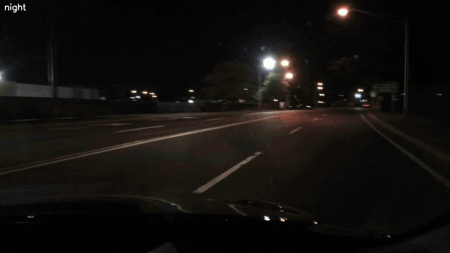
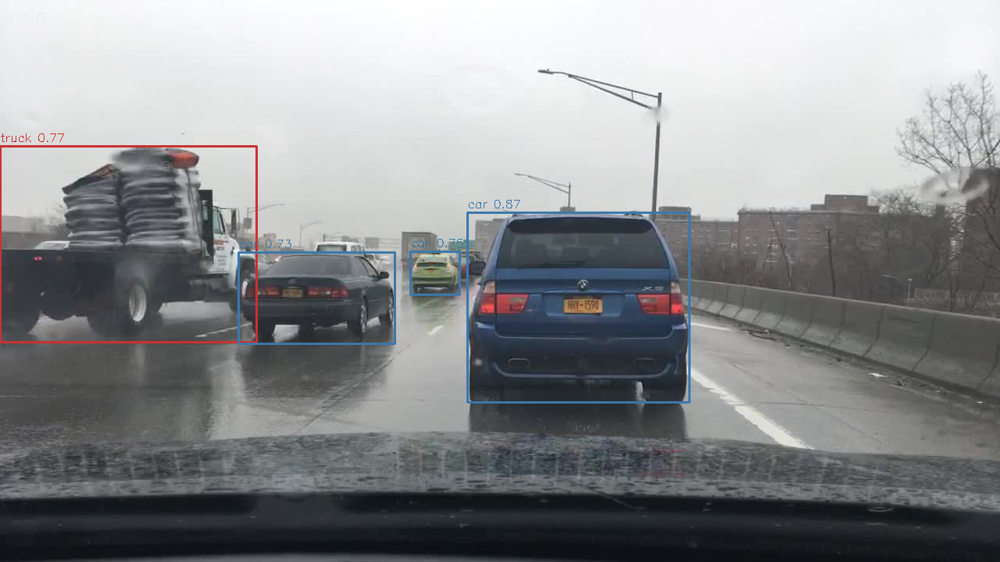
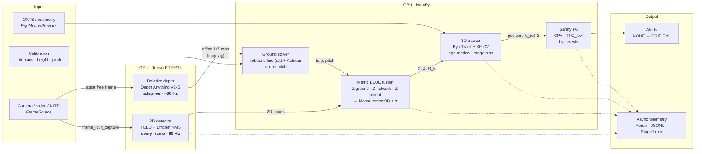
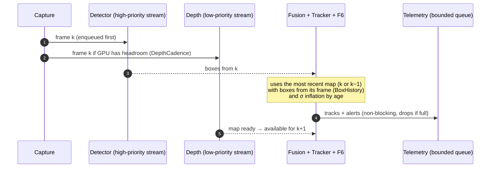
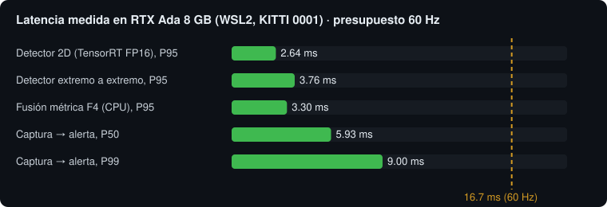

<div align="center">

# percepcion3d

**Real-time monocular 3D perception for mobile robotics and autonomous vehicles**

From a single RGB camera to metric positions $(X, Y, Z)$, relative velocity, 3D tracking, and
deterministic TTC/CPA collision alerts, with a dual-rate loop measured on edge GPU.




<sub>Demo generated with <code>scripts/make_bdd_readme_gif.py</code>: real BDD100K val keyframes
(urban night, rain, highway) + TensorRT detector boxes at 672×384. The F4–F6 synthetic scene
remains available via <code>scripts/make_readme_assets.py</code>.</sub>

</div>

**Languages:** English (this page) · [Español](README.es.md)

---

## Contents

- [What it does](#what-it-does)
- [Pipeline architecture](#pipeline-architecture)
- [Measured results](#measured-results)
- [Quick start](#quick-start)
- [Real camera · BDD100K](#real-camera--bdd100k)
- [Reproduce each phase](#reproduce-each-phase)
- [Repository structure](#repository-structure)
- [Development](#development)
- [Documentation](#documentation)

## What it does

| Stage | Module | What it provides |
|---|---|---|
| **Capture** | `io/sources.py` | KITTI (tracking and raw, with OXTS), video, V4L2, and jittered player; *latest-wins* `LatestFrameSlot` |
| **2D detector** | `detection/` | YOLO → ONNX with uint8 preprocess and in-graph `EfficientNMS_TRT`; TensorRT FP16 with CUDA Graph and letterbox with exact inverse |
| **Relative depth** | `depth/depth_trt.py` | Depth Anything V2-S in TensorRT FP16, ImageNet normalization in-graph, adaptive cadence |
| **Metric fusion** | `depth/ground_solver.py`, `depth/fusion.py` | Robust affine fit $(s,t)$ on the roadway with Kalman and $\chi^2$ gating, online pitch, BLUE of ground + network + height with variance |
| **3D tracking** | `tracking/` | ByteTrack 2D + CV Kalman in $[X, Z, V_X, V_Z]$ with variable $\Delta t$, OXTS ego-motion, and optional range-bias state |
| **Safety** | `safety/` | $t_{CPA}$/$d_{CPA}$ and $TTC_{low}$ with σ, trajectory gates, and a pure alert machine with hysteresis |
| **Integration** | `runtime/pipeline.py` | Single-thread dual-rate loop, stamped `frame_id`, priority CUDA streams, box buffer for lagged maps |
| **Telemetry** | `telemetry/rerun_sink.py` | Non-blocking bounded queue, lazy Rerun, JSONL, P50/P95/P99 and VRAM per stage |

<p align="center">
  
</p>

## Pipeline architecture



<details>
<summary><b>Dual-rate loop timing</b></summary>



</details>

## Measured results

All measured on the target hardware: **RTX Ada 8 GB under WSL2**, KITTI tracking/raw replayed at 60 Hz.

<p align="center">
  
</p>

| Phase | Metric | Result |
|---|---|---|
| F2 · Detector | `det.gpu` P50 / P95 (FP16) | 0.93 / 2.64 ms |
| | Moderate recall pedestrians / cars | 79.9 % / 81.2 % |
| F3 · Depth | Depth Anything V2-S 924×280 FP16 | ≈ 8 ms GPU |
| F4 · Metric fusion | AbsRel 0–30 / 30–60 m (seq. 0001) | 6.5 % / 5.7 % |
| F5 · Tracking | RMSE V tracks > 4 s / pool 0–30 m | 0.82 / ≈ 1.10 m/s |
| F6 · Alerts | Synthetic TTC/CPA suite | Deterministic, DoD met |
| F7 · Full loop | Capture → alert P50 / P99 | **5.93 / 9.00 ms** (budget 16.7) |
| | Depth · age P95 · drops · VRAM | 29.9 Hz · 33 ms · 0.39 % · 539 MB |
| F8 · INT8 detector | Δ pedestrian recall · Δ `det.gpu` P95 | −7.3 pt · −38 % → **rejected, FP16** |

> [!NOTE]
> **Known limitations.** The global F5 velocity RMSE (≈ 1.10 m/s vs. 1.0) is limited
> by F4 range error, correlated over time; the Kalman range-bias state
> (`--range-bias`) was measured on 21 sequences and does not help (left disabled). 3D metrics (AbsRel,
> velocity RMSE) remain KITTI-based; the jump to real camera starts with BDD100K (2D detection,
> 2D tracking, and F7 loop at 720p) — see [Real camera · BDD100K](#real-camera--bdd100k).
> Detail and decisions in [`docs/01_mvp_phase_plan.md`](docs/01_mvp_phase_plan.md).

## Quick start

```bash
git clone https://github.com/aiambo08/perception3d.git && cd perception3d
uv venv --python 3.11 && source .venv/bin/activate
uv pip install -e ".[dev]"                                   # CPU core + tooling

pytest tests -q -m "not slow and not gpu"                    # CPU suite (no GPU)
python scripts/eval_fusion_synthetic.py                      # synthetic F4 DoD
python scripts/eval_tracking_synthetic.py                    # synthetic F5 DoD
python scripts/eval_safety_synthetic.py --seeds 10           # synthetic F6 DoD
python scripts/make_readme_assets.py                         # regenerate this README's demo (ffmpeg)
```

With NVIDIA GPU (TensorRT 10, CUDA 12):

```bash
uv pip install -e ".[runtime]"                               # tensorrt-cu12, cuda-python, rerun-sdk, nvidia-ml-py
bash scripts/run_pipeline.sh kitti-tracking ~/datasets/kitti/tracking/training 0001 --ego oxts
```

## Real camera · BDD100K

The pipeline already accepts any MP4/MOV with a camera YAML. BDD100K is the cheapest
jump to real dashcam before own videos or nuScenes (3D metrics outside KITTI).
**The full GPU flow runs in WSL** (`scripts/wsl_env.sh`: venv at `~/.venvs/perception3d`).

### Measured results (720p @ 30 Hz, RTX 4060 Laptop)

| Phase | Config | Result |
|---|---|---|
| F2 · car / pedestrian recall (**10k** val, engine **672×384**) | labels 2018→det_20 | **57.4 % / 34.5 %** ([57.0, 57.8] / [33.6, 35.4]) |
| F2 · car / pedestrian recall (10k val, KITTI engine 1024×320) | same GT | 54 % / 30 % |
| F7 · capture→alert P50 / P95 / **P99** | det 672×384 + depth **700×210** | 7.2 / 14.3 / **16.6 ms** (DoD ≤ 16.7 → PASS) |
| F7 · depth | dual-rate @ 30 Hz | **15 Hz** (GPU P50 ≈ 3.9 ms; turnaround ≈ 1 frame → ceiling ~15 Hz; KITTI DoD ≥ 25 is for 60 Hz loop) |
| F7 · drops / VRAM | — | 0 % / ~230 MB → PASS |
| README demo | night / rain / highway | `docs/assets/demo.gif` via `make_bdd_readme_gif.py` |

The KITTI 1024×320 detector (3.2:1 aspect) on 16:9 leaves ~45 % letterbox; the
`configs/models_bdd.yaml` (672×384 ≈ 16:9) cuts P99 from ~22 ms to **16.6 ms**.
Depth 700×210 (multiple of 14) reduces `depth.gpu` vs. 840×252; Hz is capped by
the loop (enqueue → consume on the next frame), not the engine.

### Download (Berkeley mirror; ETH down)

Verified source: `http://dl.yf.io/bdd100k/` (HTTP, trusted network). The ZIP
`bdd100k_det_20_labels.zip` from the portal is mispackaged (2k JPGs); use
`bdd100k_labels.zip` (2018) and convert with `scripts/convert_bdd_labels_2018_to_det20.py`.

| Package | Purpose | Size |
|---|---|---|
| 100K Images + labels 2018→det_20 | F2 recall | ~5.5 GB images + 181 MB labels |
| Demo clip (keyframes) | F7 / GIF without the 1.8 TB of video | `make_bdd_demo_video.py` / `make_bdd_readme_gif.py` |
| MOT 2020 images | F5 2D | `mot20/images20-track-val-1.zip` (mirror OK) |
| MOT 2020 labels (`box_track_20`) | F5 IDSW | **offline** on ETH/Berkeley ([bdd100k#369](https://github.com/bdd100k/bdd100k/issues/369)) |

```bash
# On Ubuntu WSL:
cd ~/perception3d   # or the repo path under /mnt/c/...
export BDD=/mnt/c/Users/$USER/datasets/bdd100k

bash scripts/download_bdd100k.sh eval    # labels 2018 + images 100k + det_val.json
# F2 (10k)
bash scripts/run_bdd_eval_wsl.sh --config configs/models_bdd.yaml \
  --engine models/detector_672x384_fp16.engine --json reports/f2_bdd_val_672x384.json
# F7 (builds hold clip if missing)
DET_ENGINE=models/detector_672x384_fp16.engine \
MODELS_CFG=configs/models_bdd.yaml \
DEPTH_ENGINE=models/depth_700x210_fp16.engine \
bash scripts/run_bdd_f7_wsl.sh
# Real GIF for the README
uv run --extra runtime python scripts/make_bdd_readme_gif.py --root "$BDD" \
  --engine models/detector_672x384_fp16.engine --config configs/models_bdd.yaml
# 16:9 detector export (if the engine is not built yet)
bash scripts/build_bdd_detector_wsl.sh --f2-smoke --f7
```

Intrinsics estimated in `configs/camera_bdd.yaml` (BDD does not publish \(K\)): 1280×720,
HFOV≈78° → fx≈790, \(h\)≈1.3 m, pitch 0.

Detail on mirrors / MOT / nuScenes: [`docs/03_real_datasets.md`](docs/03_real_datasets.md).

> **Phase 2 (3D metrics outside KITTI).** nuScenes mini (~4 GB, CC BY-NC-SA 4.0, registration)
> provides 6 cameras + LiDAR + calibration and ego pose to re-measure AbsRel (F4) and RMSE (F5).
> Requires a new loader with the devkit; do it only if a reviewer asks for non-KITTI 3D numbers.

<details>
<summary><b>From-scratch setup on WSL2 (Windows 11)</b></summary>

Steps to get the machine ready from scratch (Windows 11 + WSL2 Ubuntu 22.04
or 24.04). Commands run inside WSL unless PowerShell is noted.

1. **NVIDIA driver on Windows** (no driver is installed inside WSL).
   Install the current Game Ready/Studio Driver from nvidia.com and check
   from WSL that the GPU is visible:
   ```bash
   nvidia-smi          # should list the GPU and "CUDA Version: 12.x"; if it fails, update the Windows driver
   ```
   `nvidia-smi` in WSL reports process memory with less detail than on
   native Linux (WDDM); `utils/vram.py` uses NVML and returns `null` for
   fields WDDM does not expose.
2. **System tools and `uv`:**
   ```bash
   sudo apt update && sudo apt install -y git libglib2.0-0
   curl -LsSf https://astral.sh/uv/install.sh | sh && source ~/.local/bin/env
   ```
3. **Repository and environment (Python 3.11 managed by uv):**
   ```bash
   git clone https://github.com/aiambo08/perception3d.git ~/perception3d && cd ~/perception3d
   uv venv --python 3.11 && source .venv/bin/activate
   uv pip install -e ".[dev]"                      # CPU: tests, ruff, mypy, onnxruntime
   uv pip install -e ".[runtime]"                  # GPU: tensorrt-cu12 10.x, cuda-python, rerun-sdk, nvidia-ml-py
   uv pip install -e ".[export]"                   # only to export ONNX (torch, ultralytics, transformers)
   ```
4. **Check TensorRT and cuda-python:**
   ```bash
   python -c "import tensorrt as trt, cuda; print(trt.__version__)"   # 10.x
   pytest tests -q -m "not slow and not gpu"                          # CPU suite
   ```
5. **Data and engines:**
   ```bash
   export KT=~/datasets/kitti/tracking/training     # image_02/<seq>/, label_02/<seq>.txt, oxts/<seq>.txt
   ls "$KT/image_02/0001" | head -3
   # engines (F2/F3): see "Detector" and "Depth" below; check:
   ls models/detector_1024x320_fp16.engine models/depth_924x280_fp16.engine
   pytest tests -q -m gpu -v                        # GPU smoke: one inference per engine and 5 s F7 loop if KT is set
   ```
   Keep the dataset on the Linux disk (`~/datasets`), not under `/mnt/c`:
   NTFS access from WSL is several times slower and shows up in P99.
6. **Live USB camera (optional, `V4L2Source`).** WSL2 does not see USB by
   default; share it with `usbipd-win`. In PowerShell as administrator:
   ```powershell
   winget install usbipd
   usbipd list                                     # note the camera BUSID
   usbipd bind --busid <BUSID>
   usbipd attach --wsl --busid <BUSID>             # repeat after each reconnect
   ```
   In WSL: `ls /dev/video*` should show the camera. The default WSL kernel
   does not ship `uvcvideo`; if `/dev/video0` does not appear, a WSL kernel
   built with UVC is needed (out of scope for this repo). Without a camera
   the full pipeline is tested with KITTI or video.
7. **Rerun viewer.** Under WSLg the viewer renders with `llvmpipe` (CPU) and
   competes with the loop (measured: P99 18.8 vs. 12.8 ms). For measurement,
   use `TELEMETRY=none` or `RERUN_SAVE=reports/x.rrd`; to view, open the native
   Windows viewer (`pip install rerun-sdk` and `rerun` in PowerShell) and use
   `RERUN_CONNECT=<windows-ip>:9876` from WSL.

</details>

## Reproduce each phase

<details>
<summary><b>Commands per phase (F1–F8)</b></summary>

```bash
uv run python scripts/profile_stage.py --stage rectify           # P50/P95/P99 of one stage
uv run python scripts/profile_stage.py --stage playback --hz 60  # replay + jitter
uv run python scripts/profile_stage.py --stage playback --kitti <drive_sync> --hz 60
```

Detector (F2), on the GPU machine:

```bash
uv pip install -e ".[export]"
uv run python scripts/export_detector.py --config configs/models.yaml   # YOLO → ONNX (uint8 + NMS)
uv pip install -e ".[runtime]"
bash scripts/export_trt.sh models/detector_1024x320.onnx models/detector_1024x320_fp16.engine fp16
uv run python scripts/bench_detector.py --kitti-root <tracking/training> --seqs 0000 0001 0020 \
    --frames 200 --json reports/f2_detector.json                        # P50/P95/P99 + VRAM + recall (CI95)
```

Depth (F3), on the GPU machine:

```bash
uv run python scripts/export_depth.py --config configs/models.yaml       # HF → ONNX (uint8 + ImageNet) ×3 sizes
for s in 924x280 840x252 1064x322; do
  bash scripts/export_trt.sh models/depth_$s.onnx models/depth_${s}_fp16.engine fp16
done
uv run python scripts/bench_depth.py --mode depth --frames 300           # P50/P95/P99 + VRAM per size
uv run python scripts/bench_depth.py --mode matrix --size 924x280 --pace-hz 60 \
    --kitti-drive <2011_09_26_drive_0005_sync> --frames 150 \
    --json reports/f3_matrix.json                                        # det / depth / both + Spearman LiDAR
```

Metric fusion (F4):

```bash
uv run python scripts/eval_fusion_synthetic.py --json out/f4_synth.json   # synthetic DoD + P95 CPU (no GPU)
uv run python scripts/eval_fusion_kitti.py --root <kitti_tracking/training> --seq 0000 \
    --engine models/depth_924x280_fp16.engine --json out/f4_kitti.json    # AbsRel 0–30 / 30–60 m (GPU)
```

3D tracking (F5):

```bash
uv run python scripts/eval_tracking_synthetic.py --json out/f5_synth.json  # RMSE V, Δt jitter, statics, P95 CPU
uv run python scripts/eval_tracking_kitti.py --root <kitti_tracking/training> \
    --seqs 0000 0001 0020 --ego oxts --json out/f5_kitti.json               # needs training/oxts/
```

The F4 online pitch filter is robust by default (`pitch_filter:` in
`configs/fusion.yaml`: `robust_r`, `soft_gate`, `reset_after_gated`) and the nominal
KITTI pitch is 0°. `eval_fusion_kitti.py` and `eval_tracking_kitti.py` accept
`--pitch-filter legacy --nominal-pitch-deg 2.5` to reproduce the previous filter;
the F4 JSON counts discarded measurements and out-of-gate frames in
`pitch.n_discarded` / `pitch.n_frames_gated`.

For velocity bias in turns, `eval_tracking_kitti.py` prints and stores in
`diagnostics.turn` (and in `pooled_diagnostics` across all sequences) the fit of
error vs. `ω·X` and the error by turn direction with range drift
`d(ez)/dt`. `--oxts-offset-ms` and `--lever-arm` let you sweep the OXTS↔camera offset
and lever arm (commands in `docs/01_mvp_phase_plan.md`, F5).
`diagnostics.consistency` measures, by track age, mean NIS and the ratio of the
true V_Z error to the σ predicted by the filter; `--r-scale` (scale of F4 `R`) and
`--q-vehicle` let you sweep the tuning.

Safety (F6):

```bash
uv run python scripts/eval_safety_synthetic.py --seeds 10 --json out/f6_synth.json  # alert suite + determinism
```

Integrated loop and telemetry (F7):

```bash
# CPU harness (GT boxes, no network): latencies, cadence, and JSONL telemetry, no GPU
uv run python scripts/run_pipeline.py --kitti-tracking <kitti_tracking/training> --seq 0001 \
    --boxes gt --hz 60 --loop --duration 20 --telemetry jsonl --json out/f7_cpu.json
# DoD on the target GPU: F2/F3 engines, 5 min loop, Rerun viewer (uv pip install -e ".[runtime]")
bash scripts/run_pipeline.sh kitti-tracking <kitti_tracking/training> 0001 --ego oxts
# Capture-thread variant (LatestFrameSlot) if P99 fails on CPU; no viewer
CAPTURE_THREAD=1 TELEMETRY=none bash scripts/run_pipeline.sh kitti-tracking <kitti_tracking/training> 0001
# Any video (--camera intrinsics) or KITTI raw
bash scripts/run_pipeline.sh video <clip.mp4> --camera configs/camera_kitti.yaml
# Real BDD100K dashcam (configs/camera_bdd.yaml = estimated intrinsics)
HZ=30 bash scripts/run_pipeline.sh video <bdd_clip.mov> --camera configs/camera_bdd.yaml
bash scripts/run_pipeline.sh kitti-raw <2011_09_26_drive_0005_sync>
```

The JSON report (`reports/f7_<mode>.json`) carries `stats` (P50/P95/P99 of
capture→alert, depth Hz, map age and lag, drops,
`log()` cost), `stages` (`StageTimer`), `telemetry` (enqueued / emitted /
dropped / errors), and `verdicts` per DoD criterion (`null` = not measurable
in that configuration, e.g. VRAM without GPU).

Hardening (F8), on the GPU machine:

```bash
# 1. Detector INT8 with entropy calibration on ~500 KITTI frames (saves the cache)
uv run python scripts/export_trt.py models/detector_1024x320.onnx models/detector_1024x320_int8.engine \
    --precision int8 --calib-dir "$KT/image_02/0000" "$KT/image_02/0001" "$KT/image_02/0020" \
    --calib-frames 500 --calib-cache models/detector_1024x320_int8.cache
# 2. Same benchmark with both engines and a verdict. Sequences with many pedestrians
#    (≈ 6700 moderate): with 0000/0001/0020 there are only 67 and the CI95 does not decide
for P in fp16 int8; do
  uv run python scripts/bench_detector.py --engine models/detector_1024x320_$P.engine \
    --kitti-root "$KT" --seqs 0001 0013 0015 0016 0017 0019 --frames 500 --warmup 200 \
    --json reports/det_${P}_ped.json --archive
done
uv run python scripts/compare_engines.py reports/det_fp16_ped.json reports/det_int8_ped.json \
    --json reports/det_fp16_vs_int8_ped.json # ACCEPT if Δ pedestrian recall ≥ −2 pt and det.gpu P95 drops ≥ 25 %
# 3. History: --archive on bench_detector/bench_depth/run_pipeline saves a copy under data/outputs/bench/
uv run python scripts/bench_history.py list
uv run python scripts/bench_history.py check --name pipeline   # regression if P95/P99/VRAM/drops worsen > 10 % and > 0.2
# 4. GPU smoke tests (skipped without tensorrt/cuda-python or without engines)
KT="$KT" uv run pytest tests -q -m gpu -v
# 5. Regenerate engines in a pinned nvidia/cuda image (requires NVIDIA Container Toolkit)
docker build -f docker/Dockerfile.trt -t percepcion3d-trt .
docker run --rm --gpus all -v "$PWD/models:/workspace/models" percepcion3d-trt \
    models/detector_1024x320.onnx models/detector_1024x320_fp16.engine --precision fp16
```

`compare_engines.py` returns 0 with `ACCEPT` and 1 with `REJECT`; the JSON carries
Δrecall per class with its CI95 (`recall_conclusive=false` warns that the
interval crosses the threshold and more frames are advisable) and Δlatency per stage.
`bench_history.py check` returns 1 on regressions and 2 if the
entry is missing; files `data/outputs/bench/<YYYYMMDD_HHMMSS>_<name>.json`
are versioned on purpose (they are small) so history travels with the
repo.

</details>

## Repository structure

```text
perception3d/
├── configs/            # camera (KITTI / BDD), models, fusion, tracking, and safety (YAML)
├── docker/             # Dockerfile.trt: pinned nvidia/cuda image to regenerate engines
├── docs/               # EN docs (primary) + docs/es/ (Spanish) + README assets
├── scripts/            # ONNX/TRT export, benches, KITTI/BDD/synthetic evals, loop runner
├── src/percepcion3d/
│   ├── camera/         # intrinsics, extrinsics, pinhole geometry, rectification
│   ├── io/             # KITTI, video, V4L2 sources
│   ├── detection/      # letterbox, ONNX surgery, TensorRT detector, INT8 calibration
│   ├── depth/          # TensorRT depth, ground solver, sampling, and metric fusion
│   ├── tracking/       # ByteTrack, CV Kalman (+ range bias), ego-motion, Tracker3D
│   ├── safety/         # CPA/TTC kinematics, gates, and alert machine
│   ├── runtime/        # CUDA, TrtEngine, buffers, dual-rate loop
│   ├── telemetry/      # async sinks and Rerun
│   ├── sim/            # deterministic synthetic scenes
│   ├── eval/           # KITTI, BDD100K, and synthetic metrics per phase
│   └── utils/          # P50/P95/P99 profiling, VRAM (NVML), benchmark history
└── tests/              # pytest (slow and gpu markers)
```

## Development

```bash
uv venv --python 3.11 && uv pip install -e ".[dev]"      # CPU core + tooling
ruff check src scripts tests && ruff format --check src scripts tests
mypy src tests
pytest tests -m "not slow and not gpu"
pytest tests -m gpu                                       # only with GPU + engines; skipped if missing
```

Optional groups (`pyproject.toml`):

| Extra | Contents | When |
|---|---|---|
| *(core)* | numpy, opencv-headless, pyyaml, scipy | always; CI |
| `runtime` | tensorrt-cu12 10.x, cuda-python, rerun-sdk, nvidia-ml-py | inference and VRAM on the target GPU |
| `export` | torch, torchvision, ultralytics, transformers, onnx | export ONNX (detector and depth) |
| `dev` | pytest, ruff, mypy, onnx, onnxruntime | development and CI (ONNX surgery tests on CPU) |

## Documentation

| Document | Contents |
|---|---|
| [`docs/00_critical_analysis.md`](docs/00_critical_analysis.md) | Risks, trade-offs (latency vs. accuracy, memory vs. robustness), and mitigations per stage |
| [`docs/01_mvp_phase_plan.md`](docs/01_mvp_phase_plan.md) | Phases F0–F8, Definition of Done, measurement strategy, and results with decisions |
| [`docs/02_technical_document.md`](docs/02_technical_document.md) | Full technical document: theory (formulas, theorems, references), design, and mapping to code, phase by phase |
| [`docs/03_real_datasets.md`](docs/03_real_datasets.md) | Real datasets (BDD100K, MOT, nuScenes): mirrors, download, and evaluation notes |

Spanish copies live under [`docs/es/`](docs/es/) and [`README.es.md`](README.es.md).
