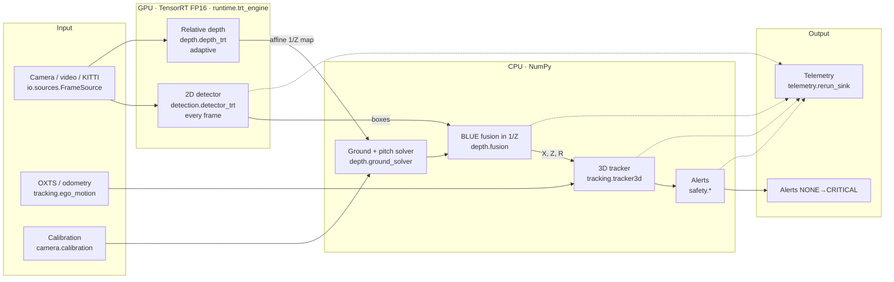
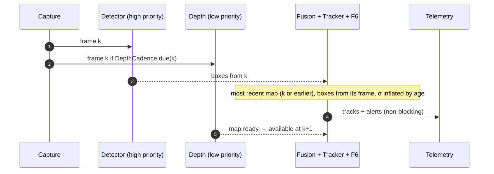

# perception3d — Technical document: theory, design, and code

> **Languages:** English (this page) · [Español](es/02_documento_tecnico.md)

> Reference document for the full project (phases F0–F8). It explains **what** each
> stage does, **why** it was designed that way, the **theory** it rests on (with formulas and
> references), and **where** it is implemented in the code. It complements
> [`00_critical_analysis.md`](00_critical_analysis.md) (risks and alternatives evaluated before
> coding) and [`01_mvp_phase_plan.md`](01_mvp_phase_plan.md) (plan, per-phase DoD, and measurement
> log). The [`README.md`](../README.md) is the quick entry point (English primary; Spanish:
> [`../README.es.md`](../README.es.md)).

---

## Table of contents

1. [How to read this document](#1-how-to-read-this-document)
2. [The problem and the architecture](#2-the-problem-and-the-architecture)
3. [Conventions: frames, units, and notation](#3-conventions-frames-units-and-notation)
4. [F0 · Critical analysis and plan](#4-f0--critical-analysis-and-plan)
5. [F0.1 · Camera geometry and ground plane](#5-f01--camera-geometry-and-ground-plane)
6. [F1 · Measurement, I/O, and simulation](#6-f1--measurement-io-and-simulation)
7. [F2 · 2D detector in TensorRT](#7-f2--2d-detector-in-tensorrt)
8. [F3 · Relative depth](#8-f3--relative-depth)
9. [F4 · Metric fusion](#9-f4--metric-fusion)
10. [F5 · 3D tracking and ego-motion compensation](#10-f5--3d-tracking-and-ego-motion-compensation)
11. [F6 · Relative kinematics and alerts](#11-f6--relative-kinematics-and-alerts)
12. [F7 · Dual-rate loop and telemetry](#12-f7--dual-rate-loop-and-telemetry)
13. [F8 · Hardening: INT8, history, and reproducibility](#13-f8--hardening-int8-history-and-reproducibility)
14. [Validation: tests, DoD, and evaluation](#14-validation-tests-dod-and-evaluation)
15. [Decision history (PR by PR)](#15-decision-history-pr-by-pr)
16. [Known limitations and future work](#16-known-limitations-and-future-work)
17. [References](#17-references)

---

## 1. How to read this document

Each phase follows the same outline:

| Block | Content |
|---|---|
| **Goal** | What the phase delivers and what acceptance criterion (DoD) it had |
| **Theory** | Mathematical models, derivations, and theorems it rests on |
| **Design** | Engineering decisions and discarded alternatives |
| **Code** | Modules, classes, and functions that implement each equation |
| **Measured** | Results on the target GPU (RTX Ada 8 GB under WSL2, KITTI reproduced) |

Code paths are relative to `src/percepcion3d/` unless stated otherwise
(`scripts/`, `configs/`, `tests/`). Formulas use the notation from section 3.
Bibliographic references are numbered `[n]` and listed at the end.

All "measured" figures come from the user's runs on their GPU, collected in the
JSON files under `reports/` and annotated in `01_mvp_phase_plan.md`; nothing in this document
was measured in CI or on the development machine (which has no GPU).

---

## 2. The problem and the architecture

### 2.1 Problem

From **a single RGB camera** mounted on a vehicle or robot, estimate in real time, for
each relevant object (cars, pedestrians, cyclists…):

- the metric ground position $(X, Z)$ relative to the camera and its uncertainty;
- the relative velocity $\mathbf{v}_{rel}$ and, if ego-motion is known, the
  ground-plane velocity;
- a persistent identity (track);
- a deterministic collision alert (time to collision, closest point of approach).

And do so under a budget of **16.7 ms per frame** (60 Hz) on an 8 GB laptop GPU.

The central difficulty of monocular vision is that an image does not contain scale: a large
car far away and a small one nearby produce the same projection. All metric depth must
come from **prior knowledge**: camera height above the ground, a flat-ground hypothesis,
typical heights of object classes, or a trained depth model.
The project combines the first three with a **relative** depth model (which gives shape,
not scale) and fuses them with their uncertainties.

### 2.2 Architecture



The orchestrator is `runtime.pipeline.Pipeline` (F7). Each plan phase added a layer:

| Phase | Package | Delivery |
|---|---|---|
| F0 | `docs/` | Risk analysis, phased plan with measurable DoD |
| F0.1 | `camera/` | Pinhole + ground geometry with propagated variance |
| F1 | `utils/`, `io/`, `runtime/buffer.py`, `sim/`, `eval/kitti.py` | Percentiles, sources, *latest-wins* buffer, synthetic scene, KITTI GT |
| F2 | `detection/`, `runtime/trt_engine.py` | YOLO detector in TensorRT with in-graph NMS |
| F3 | `depth/depth_trt.py`, `depth/preprocess.py`, `eval/lidar.py` | Depth Anything V2-S in TensorRT, validation against LiDAR |
| F4 | `depth/ground_solver.py`, `depth/sampling.py`, `depth/fusion.py` | Metric scale and three-cue fusion |
| F5 | `tracking/` | ByteTrack + Kalman CV with ego-motion |
| F6 | `safety/` | CPA, TTC, and alert machine |
| F7 | `runtime/pipeline.py`, `runtime/cuda.py`, `telemetry/` | Dual-rate loop, asynchronous telemetry |
| F8 | `detection/int8_calibration.py`, `eval/engine_compare.py`, `utils/bench_history.py`, `docker/` | INT8, A/B verdict, history, Docker |

---

## 3. Conventions: frames, units, and notation

**Camera frame C** (optical, OpenCV): $X_c$ right, $Y_c$ down, $Z_c$ forward along the
optical axis. **Depth** $Z$ is always the $Z_c$ coordinate (optical depth), not the
ray length. This is the KITTI convention (`location.z`) and that of the pinhole model.

**Ground frame G**: same origin (optical center), $X_g$ right, $Y_g$ down, $Z_g$ forward
**parallel to the ground**. The ground is the plane $Y_g = h$, with $h$ the camera height.
It is obtained from C by rotating *pitch* $\theta$ (positive looking down) and *roll* $\rho$:

$$
R_{cg} = R_x(\theta)\,R_z(\rho), \qquad \mathbf{p}_g = R_{cg}\,\mathbf{p}_c
$$

(`camera.geometry.camera_to_ground_rotation`, `PinholeGeometry.camera_to_ground`).

**Intrinsics** $K$: $f_x, f_y, c_x, c_y$ in pixels (`camera.calibration.CameraIntrinsics`).
Normalized coordinates: $x = (u - c_x)/f_x$, $y = (v - c_y)/f_y$.

**Inverse depth** $\rho = 1/Z$ (m⁻¹). All of F4 fusion works in $\rho$.

**Time**: `t_capture_ns` is the scene clock (dataset or capture timestamps) and
drives Kalman and TTC; `t_ingress_ns` is the local monotonic clock and measures latencies.
Intervals $\Delta t$ are variable (no fixed rate is assumed).

**Uncertainty**: $\sigma$ is the 1-σ standard deviation; $P$, $R$, $Q$, and $\Sigma$ are covariances.
"Conservative" bounds use $k\sigma$ with $k = 1.5$ by default.

**Percentiles**: P50, P95, P99 of latencies, measured with `perf_counter_ns` (CPU) or CUDA
events (GPU).

---

## 4. F0 · Critical analysis and plan

**Goal.** Before writing code, identify the risks that could invalidate the
approach and set measurable per-phase acceptance criteria.

**Content** ([`00_critical_analysis.md`](00_critical_analysis.md)): for each stage of the proposed
pipeline, risks (R1–R9), trade-offs, and mitigations were analyzed. Those that most shaped the
design:

| Risk | Statement | Mitigation that ended up in the code |
|---|---|---|
| R1 | Relative monocular depth has no scale; recovering it from the objects is circular | Scale from the **roadway** (thousands of pixels with known geometric depth) rather than from the objects to be measured (§9.2) |
| R2 | Mount pitch changes (braking, load) and its error grows with $Z^2$ | **Online** pitch from class heights (§9.4) and propagated variance (§5.3) |
| R3 | Two networks competing for the GPU break the detector budget | Streams with **priority** and **adaptive** depth (§7.4, §12.2) |
| R4 | Non-Gaussian errors in the depth map (edges, sky, occlusions) | Robust statistics (median/MAD, Otsu) and $\chi^2$ gates (§9.3, §9.5) |
| R5 | Velocity from finite differences of noisy $Z$: amplifies the error | Kalman with continuous white-noise acceleration model, variable $\Delta t$ (§10.3) |
| R6 | Depth map lagged relative to the boxes | Boxes from the map's frame (`BoxHistory`) + $\sigma$ inflation by age + KF retrodiction (§12.3) |
| R7 | Flickering alerts | Hysteresis in value and in time, deterministic machine (§11.3) |
| R8 | Ego-motion is confused with object motion | State with **ground-plane** velocity and ego-motion in the prediction (§10.4) |
| R9 | Telemetry blocks the loop | Bounded queue with drop and a separate thread (§12.4) |

**Plan** ([`01_mvp_phase_plan.md`](01_mvp_phase_plan.md)): phases F0.1–F8 each with a numeric
*Definition of Done* (P95/P99, AbsRel by bins, velocity RMSE, VRAM…). The final
log of each phase records what was measured and any deviations.

---

## 5. F0.1 · Camera geometry and ground plane

**Goal.** An exact, tested geometry module: projection, deprojection,
ground intersection, and **variance propagation**. Everything metric in the project rests
on it. PR: [#2](https://github.com/aiambo08/perception3d/pull/2).

### 5.1 Pinhole model

A point $\mathbf{p}_c = (X_c, Y_c, Z_c)$ projects to

$$
u = f_x \frac{X_c}{Z_c} + c_x,\qquad v = f_y \frac{Y_c}{Z_c} + c_y
$$

and, given optical depth $Z_c$, one recovers $\mathbf{p}_c = Z_c\,(x, y, 1)$
[1, ch. 6]. Code: `PinholeGeometry.project_point`, `deproject_pixel_with_depth`,
`deproject_pixel_to_ray`. The **geometric reversibility** test (`tests/test_geometry.py`)
requires that project and deproject be the identity to $10^{-9}$.

### 5.2 Distortion rectification

Real lenses are not pinhole. The Brown–Conrady model [2] corrects radial distortion
$(k_1, k_2, k_3)$ and tangential $(p_1, p_2)$:

$$
x_d = x(1 + k_1 r^2 + k_2 r^4 + k_3 r^6) + 2p_1 xy + p_2(r^2 + 2x^2),\quad r^2 = x^2 + y^2
$$

`camera.undistort.ImageRectifier` precomputes the remap maps (`cv2.initUndistortRectifyMap`)
once and applies `cv2.remap` per frame; after rectification, the effective intrinsics
are those of the undistorted virtual camera. KITTI already comes rectified, so in
evaluations this stage is identity.

### 5.3 Ground intersection

For the ray of pixel $(u, v)$, in frame G, the vertical component of the unit ray is
$d_y = (R_{cg}\,\mathbf{r}_c)_y$. With plane $Y_g = h$, the contact point is at
$\mathbf{p}_g = (h/d_y)\,R_{cg}\mathbf{r}_c$. For zero roll and $\alpha = \arctan y$ (ray angle
below the optical axis), the closed forms are:

$$
Z_c = \frac{h\cos\alpha}{\sin(\theta + \alpha)},\qquad
d_{long} = \frac{h}{\tan(\theta + \alpha)},\qquad
\ell = \frac{h}{\sin(\theta + \alpha)}
$$

where $Z_c$ is optical depth, $d_{long}$ planar forward distance, and $\ell$ the
Euclidean ray length (`PinholeGeometry.compute_ground_distances`, `ground_hits`).

> **F0.1 fix.** The inherited code returned $\ell$ as depth. Since
> $\ell > Z_c$ always, all distances were biased high and the error grew with
> $\alpha$. PR [#2](https://github.com/aiambo08/perception3d/pull/2) fixed $Z_c = h\cos\alpha/\sin(\theta+\alpha)$
> and added a closed-form value test with KITTI intrinsics.

The **horizon** is the row where the ray is parallel to the ground ($d_y = 0$):
$v_h = c_y - f_y\tan\theta$ with no roll; with roll it is a line $\mathbf{n}\cdot\mathbf{r}_c = 0$
(`get_horizon_v(u)`). Pixels on or above the horizon do not hit the ground and are marked
`valid = False` in the vectorized API, rather than raising.

**Affine form of ground inverse depth.** With zero roll,

$$
\rho_g(v) = \frac{1}{Z_c} = \frac{\sin\theta + y\cos\theta}{h},\qquad y = \frac{v - c_y}{f_y}
$$

is **exactly linear in the row**. This identity is the key to the F4 solver (§9.2) and to
its observability limit.

### 5.4 Variance propagation (delta method)

The two dominant error sources are pitch (mount, braking) and the contact row
(detector *jitter*). With independent $\sigma_\theta$ and $\sigma_v$, to first order [3]:

$$
\sigma_Z^2 \approx \left(\frac{\partial Z}{\partial\theta}\right)^2\sigma_\theta^2
 + \left(\frac{\partial Z}{\partial v}\right)^2\sigma_v^2
$$

`ground_hits` computes the derivatives by centered differences on the exact geometry
(steps $10^{-6}$ rad and $10^{-3}$ px), keeping them consistent with roll. Far from the
camera, $\partial d/\partial\theta \approx d^2/h$, so $\sigma_d \approx (d^2/h)\,\sigma_\theta$:
**pitch error grows with the square of distance**, the reason pitch is
estimated online in F4. `GroundNoiseModel` holds $\sigma_\theta$ (0.5° by default) and $\sigma_v$
(1 px). Tests check the variance against Monte Carlo.

---

## 6. F1 · Measurement, I/O, and simulation

**Goal.** The tools to measure rigorously before optimizing, the frame sources, and
a synthetic generator with ground truth. PR: [#3](https://github.com/aiambo08/perception3d/pull/3).

### 6.1 Latency percentiles

Means hide the tails; in real time what matters is the frequent worst case. The plan
sets DoD on **P50/P95/P99**. `utils.profiling.StageTimer` uses fixed-capacity *ring buffers*
(no allocation on the hot path) and `perf_counter_ns`; GPU times measured with
CUDA events are injected via `record`. It exports table, JSON, and CSV. `utils.vram` samples
GPU memory via NVML (under WDDM/WSL2 some fields are unavailable and returned as
`null`).

### 6.2 *Latest-wins* buffer

With capture at 60 Hz and a slower consumer, a FIFO queue accumulates unbounded latency.
`runtime.buffer.LatestFrameSlot` stores **one** frame: `put` overwrites the unconsumed one (and
counts it as dropped) and `get` blocks until a newer one arrives. Memory is bounded to
one frame and latency to one capture period.

### 6.3 Sources

`io.sources.FrameSource` is the common protocol; `VideoFileSource`, `KittiSequenceSource`
(with OXTS and dataset timestamps), and `V4L2Source` (live camera) implement it.
`runtime.playback` plays a source at a target rate with configurable *jitter* to
exercise the loop with variable $\Delta t$.

### 6.4 Synthetic scene

`sim.synthetic.SyntheticScene` generates 3D objects at constant velocity and produces exactly what
the pipeline consumes: noisy 2D boxes, contact rows, and an **affine** inverse-depth map
($\hat d = s/Z + t$ plus multiplicative noise), as a relative depth model would.
It allows testing F4–F6 in CI without a GPU and is what generates the README demo
(`scripts/make_readme_assets.py`).

### 6.5 KITTI ground truth

`eval.kitti` loads `label_02/XXXX.txt` (tracking): the 3D box `z` is the object's optical
depth and `track_id` gives tracking GT without projecting LiDAR. Metrics by distance bins:
**AbsRel** $= \frac{1}{N}\sum |Z - Z_{gt}|/Z_{gt}$ and RMSE.

---

## 7. F2 · 2D detector in TensorRT

**Goal.** Per-frame classed 2D boxes in $\le 6$ ms P95 and $\le 900$ MB VRAM, with recall
verified after export. PR: [#4](https://github.com/aiambo08/perception3d/pull/4).

### 7.1 Model

YOLO11n (Ultralytics) [4], input **1024×320**: KITTI is 1242×375 (≈3.3:1); a square
640×640 would waste ~70 % of the tensor on padding, while 1024×320 leaves ~4 %. The cost
of a convolutional network scales with input pixels, so the rectangular shape
buys horizontal resolution (distant pedestrians) at the same cost.

### 7.2 Exact letterbox

`detection.letterbox.Letterboxer` scales by a single factor $s$ and pastes onto a preallocated
`uint8` canvas with integer offset $(p_x, p_y)$:

$$
u_{net} = s\,u + p_x,\qquad u = (u_{net} - p_x)/s
$$

By storing $s$ as the real size ratio (not rounded), the inverse is exact to
$10^{-9}$ px (round-trip test). That prevents letterbox rounding error from
becoming contact-row error, which F4 amplifies.

### 7.3 ONNX graph surgery

`detection.onnx_surgery` edits the ONNX protobuf without TensorRT:

1. `prepend_uint8_preprocess`: the input becomes `uint8 [1,H,W,3]` BGR (what OpenCV gives) and
   the graph incorporates `Cast → Transpose → BGR→RGB → /255` (and optionally
   $(x-\mu)/\sigma$ per channel, folded into a `Mul` + `Add`). The host uploads **1 byte/pixel** with no
   `astype` or `transpose`.
2. `append_efficient_nms`: replaces the raw output `[1, 4+C, N]` with the
   `EfficientNMS_TRT` plugin, which returns `num_dets`, `det_boxes`, `det_scores`, `det_classes`.
   NMS on GPU eliminates copying thousands of candidates to the host.

### 7.4 TensorRT engine and asynchrony

`runtime.trt_engine.TrtEngine` (behind the `EngineBackend` protocol, replaceable by a
*fake* in tests) owns preallocated device and *pinned* buffers, a stream (high priority
for the detector), start/end events to measure GPU time, and optionally a
**CUDA Graph** of `execute_async_v3` that reduces launch cost. `infer_async`
returns a *handle*; `wait()` synchronizes with **one event**, never with
`cudaDeviceSynchronize`, so detector and depth can overlap on the GPU (R3).
`runtime.cuda.CudaRuntime` wraps `cuda-python` with injectable `cudart`.

### 7.5 Export validation

`eval.detection` measures **recall** by KITTI type (greedy IoU matching, COCO→KITTI map)
on *moderate* objects. It is a check that the engine still finds the objects, not
a model quality metric. The confidence interval uses **Wilson** [5], which behaves
well with few samples (sequences 0000/0001/0020 have only 67 pedestrians; to decide
we had to add 0013/0015/0016/0017/0019, ≈6700 pedestrians — PR [#7](https://github.com/aiambo08/perception3d/pull/7)).

**Measured (FP16):** `det.gpu` P50/P95 = 0.93/2.64 ms; moderate recall pedestrians 79.9 %, cars
81.2 %; VRAM within budget.

---

## 8. F3 · Relative depth

**Goal.** A dense relative inverse-depth map at ≈30 Hz that coexists with the
detector. PR: [#5](https://github.com/aiambo08/perception3d/pull/5).

### 8.1 Model and affine ambiguity

Depth Anything V2-Small [6] (ViT-S, 25 M parameters) is trained with MiDaS's
**scale- and shift-invariant** loss [7], so its output is an affine-invariant
disparity:

$$
\hat d(u, v) = s\cdot\frac{1}{Z(u,v)} + t,\qquad (s, t)\ \text{unknown and different every frame}.
$$

The metric variant exists but generalizes worse across cameras; the relative one was chosen and
$(s, t)$ are recovered in F4 from geometry. The *default* is `variant: relative` in
`configs/models.yaml`; the metric option remains available.

### 8.2 Input size and preprocessing

A ViT has cost $\mathcal{O}(N^2)$ in the number of tokens $N$ (14×14 patches). It is exported at
**924×280** (1320 tokens, equivalent to the 518×518 training size) with alternatives 840×252 and
1064×322 measured in `scripts/bench_depth.py`. Unlike the detector, the image is
**stretched** without borders (`depth.preprocess`): gray borders would enter global attention and
shift every pixel's disparity, and padding tokens are wasted compute.
The residual anisotropy (1242×375 → 924×280) is ≲1 %. `DepthResize` stores the
frame↔network map so boxes can be sampled without resizing the map.

### 8.3 Validation against LiDAR

Because $(s, t)$ are unknown, an absolute metric is meaningless; what is invariant is the
**order** of the pixels. `eval.depth_sanity` computes **Spearman's ρ** between $\hat d$ and
$1/Z_{lidar}$ on roadway pixels (dense LiDAR, smooth surface): $\rho \ge 0.95$ indicates a
healthy export; a drop indicates inverted channel, wrong normalization, or FP16 overflow,
not metric error. `eval.lidar` projects Velodyne to the rectified camera
($x_{cam} = P_2\,[R_{rect}|0]\,T_{velo\to cam}\,x_{velo}$) and keeps the nearest return per
pixel. As a secondary diagnostic, `affine_abs_rel` fits $(s, t)$ with Theil–Sen and gives the
AbsRel achievable on that frame (lower bound for F4).

**Measured:** ≈8 ms GPU in FP16; with the detector in flight the latter's P99 stays
within DoD thanks to priority streams.

---

## 9. F4 · Metric fusion

**Goal.** Turn 2D boxes and a relative map into a metric measurement $(X, Z) \pm \sigma$ per
object, with AbsRel $\le 10$ % in 0–30 m and $\le 20$ % in 30–60 m, in $\le 2$ ms CPU per
frame. PRs: [#6](https://github.com/aiambo08/perception3d/pull/6), [#11](https://github.com/aiambo08/perception3d/pull/11),
[#12](https://github.com/aiambo08/perception3d/pull/12), [#18](https://github.com/aiambo08/perception3d/pull/18).
This is the most theory-heavy phase; it is organized in five pieces.

### 9.1 Three depth cues per box

For a box of class $c$, with bottom row $v_b$, center column $u_b$, and height $h_{px}$:

| Cue | Formula | Error source | When it is gated off |
|---|---|---|---|
| **Ground** $Z_g$ | intersection of ray $(u_b, v_b)$ with the ground (§5.3) | pitch, contact row | box truncated by the bottom edge, class that does not touch the ground, above the horizon |
| **Net** $Z_n$ | $s/(\hat d_{box} - t)$ with $\hat d_{box}$ a robust map statistic | network noise, $(s,t)$, occlusions | no map, no valid sample, beyond the fit range |
| **Height** $Z_h$ | $f_y H_c / h_{px}$ with $H_c$ the class typical height | class height dispersion (σ in `configs/fusion.yaml`), vertical truncation | box truncated top/bottom, $h_{px} < 12$ px, class without prior |

Code: `depth.fusion.MetricFuser.fuse` (blocks `ground cue`, `net cue`, `height cue`) and the
`FusionFlag` flags that explain why each cue was gated off. `Measurement3D` keeps the
three cues, their σ, the weights, and the $\chi^2$ so fusion can be audited.

### 9.2 Recovering scale from the roadway

**Idea (R1 mitigation).** Every roadway pixel under the horizon has known geometric
depth $Z_c(u, v)$ (§5.3), so thousands of $(\hat d, 1/Z_c)$ pairs per frame
determine $(s, t)$ **without touching the objects** that will later be measured. This breaks the
circularity of recovering scale from the objects themselves.

**Sampling** (`ground_solver.sample_road`): region under the horizon with margin, lateral band
around the principal column, $Z \in [3, 60]$ m, excluding dilated boxes (objects and
their shadows). Network-resolution geometry is cached by $(resize, extrinsics)$ in
`GroundGridCache`, quantizing pitch to 0.1°, so per-frame cost is only the fit.

**Robust fit** (`robust_affine_fit`). The roadway contains *outliers* (markings, shadows,
undetected cars). A **Theil–Sen** [8] variant is used: median of the slopes of
2000 random pairs (instead of all $\mathcal{O}(n^2)$ pairs), then $t_0$ as the median of
$\hat d - s_0 x$, robust scale $\sigma_r = 1.4826\cdot\text{MAD}$ [9], inliers
$|r| \le 3\sigma_r$, and a least-squares refinement on them whose covariance is
$\text{Cov}(s,t) = \hat\sigma^2 (A^\top A)^{-1}$ with $A = [x, 1]$. Practical breakdown point
≈29 %, ~0.2 ms for 2000 points.

**Temporal filter** (`AffineKalman`). $(s, t)$ vary slowly; they are modeled as a random
walk with $Q = \text{diag}(q_s^2, q_t^2)\,\Delta t$ (relative to $|s|$) and fused with
a 2-dof $\chi^2$ gate at 99 % ($9.21$) on the innovation
$\nu^\top (P + R)^{-1}\nu$. An `r_floor_rel` floor on $R$ avoids overconfidence of the fit
(thousands of pixels with correlated residuals yield an optimistic formal covariance). After 15
consecutive rejections, the filter resets on the measurement.

**Pitch unobservability theorem.** With zero roll, §5.3 gives
$\rho_g(v) = (\sin\theta + y\cos\theta)/h$, affine in $y$. If the assumed pitch $\theta'$ is
wrong, $\hat d$ remains **exactly affine** in $1/Z_c(\theta')$:

$$
\hat d = s\rho(\theta) + t = s\frac{\sin\theta + y\cos\theta}{h} + t
= s'\,\rho(\theta') + t'
\quad\text{with}\quad
s' = s\frac{\cos\theta}{\cos\theta'},\;
t' = t + \frac{s}{h}\left(\sin\theta - \cos\theta\tan\theta'\right).
$$

The fit is perfect and $(s', t')$ **silently absorb the pitch error**. Deprojecting the
roadway with that $(s', t')$ and fitting a plane (`fit_plane`) returns $\theta'$, the hypothesis, not
the true pitch. Conclusion: *pitch is not observable from roadway + affine-invariant map*; a
second metric cue is needed (metric model with $t \equiv 0$, or objects of known height).
`tests/test_fusion.py` locks this behavior; it is the reason §9.4 exists.

### 9.3 Robust box statistic

A box contains object **and** background (road ahead, sky, buildings). `depth.sampling`
works in an interior ROI (20 % crop per side), excludes occluding boxes (those that
overlap and have a lower bottom edge, i.e., closer —
`fusion.occlusion_matrix`), and takes the **median**, which resists up to 50 % contamination,
with median σ $\approx 1.2533\cdot\sigma_{MAD}/\sqrt{n}$ [9].

For **thin** classes (pedestrian, cyclist) the object may be a minority and the median falls on the
background. **Bimodality** is detected with a **1-D Otsu** [10] on the sorted values: if
$|\text{med}_{hi} - \text{med}_{lo}| > 4\sigma_{pooled}$ and each cluster has $\ge 15$ % of the
pixels, the **near** cluster (larger $1/Z$) is taken for thin classes and the majority for
the rest (`sample_box`, `otsu_split`).

Conversion to depth via the delta method: $Z = s/(\hat d - t)$,
$\sigma_Z \approx Z^2\sigma_\rho$ (`disparity_to_depth_batch`); the cue is gated off (`NET_BEYOND`)
if $\hat d - t \le 0$, i.e., farther than the fit reaches.

### 9.4 Online pitch from class heights

For each box with a height prior and visible contact, $Z_h$ and contact row $v_b$
determine the pitch that makes the geometry consistent: from $\rho_g = (\sin\theta + y\cos\theta)/h$,

$$
\sin\theta + y\cos\theta = \frac{h}{Z_h}
\;\Rightarrow\;
\theta = \arcsin\!\left(\frac{h}{Z_h\sqrt{1+y^2}}\right) - \arctan y
$$

(`pitch_from_contact`), with $\sigma_\theta$ propagated from $\sigma_{Z_h}$
(`pitch_sigma_from_depth_sigma`, $\partial\theta/\partial Z = -h/(Z^2(\cos\theta - y\sin\theta))$).

`PitchEstimator` is a scalar Kalman on $\theta$ (random walk, $q = 0.3°/\sqrt{s}$,
prior $\sigma_0 = 1°$ around the nominal) fed by the **weighted median** of the
object pitches in the frame. Its formal variance is $\frac{\pi}{2}\big/\sum w_i$ (asymptotic
efficiency of the median [11]). Three hardenings from PR [#18](https://github.com/aiambo08/perception3d/pull/18):

- `robust_r`: if the real dispersion (MAD) of the pitches clearly exceeds the formal σ
  ($> 4\times$ in variance), use $\frac{\pi}{2}\sigma_{MAD}^2/n$. Real dispersion comes from
  the local ground slope under each object and from class height variety, which the
  formal σ does not see.
- `soft_gate`: outside the $\chi^2$ gate (1 dof, 99 %: 6.635) do not discard, but inflate
  $R$ so the innovation sits just on the gate — a **Huber/IRLS** step [12]. A hard gate
  with a very confident state would block a genuine change for seconds (frames 108–128
  of sequence 0001).
- `reset_after_gated`: 10 consecutive frames outside the gate reset the filter on the measurement.

Measurements more than 3° from the nominal are discarded outright (`max_step_rad`).

> **Finding.** The KITTI nominal pitch in `configs/camera_kitti.yaml` was 2.5° and the filter
> converged to a mean residual of −0.48°; with the nominal at 0° and the robust filter the residual
> landed at +0.18° and AbsRel dropped from 8.7/9.1 % to **6.5/5.7 %** (0–30/30–60 m, seq. 0001).

### 9.5 BLUE fusion in inverse depth with correlated error

**Why in $\rho = 1/Z$ and not in $Z$.** In $\rho$ the error models are (almost) linear:
$\rho_g$ is linear in the row and its pitch sensitivity $\partial\rho_g/\partial\theta \approx 1/h$
does not depend on distance; $\rho_n$ is affine in the network output by construction;
$\rho_h \propto h_{px}$. In $Z$ the same errors have heavy far tails ($Z = 1/\rho$
explodes near the horizon), and a Gaussian BLUE in $Z$ underweights exactly the bad distant
samples. Depth and its σ are recovered at the end: $Z = 1/\hat\rho$, $\sigma_Z = \sigma_\rho/\hat\rho^2$.

**Correlation between cues.** $\rho_g$ and $\rho_n$ **are not independent**: both inherit
pitch error — $\rho_n$ through the $(s,t)$ fit on the roadway with that same pitch
(§9.2). An inverse-variance average would count them twice. Fusion is the **best
linear unbiased estimator** (BLUE, Gauss–Markov theorem [13]) under

$$
\Sigma = D + \mathbf{c}\mathbf{c}^\top,\qquad D = \text{diag}(\sigma_i^2),\qquad
c_i = \frac{\partial\rho_i}{\partial\theta}\,\sigma_\theta\ (c_h = 0)
$$

$$
\mathbf{w} = \frac{\Sigma^{-1}\mathbf{1}}{\mathbf{1}^\top\Sigma^{-1}\mathbf{1}},\qquad
\hat\rho = \mathbf{w}^\top\boldsymbol{\rho},\qquad
\sigma_{\hat\rho}^2 = \frac{1}{\mathbf{1}^\top\Sigma^{-1}\mathbf{1}}.
$$

That $c_h = 0$ (height does not depend on pitch) is exactly what lets the height cue
**rescue the far field** when pitch is wrong. Code: `fuse_correlated` (scalar) and
`fuse_correlated_batch` (vectorized over $[N, 3]$; inactive cues get
$\sigma = 10^4$ to null their weight while keeping conditioning).

**Consistency test.** The statistic $\chi^2 = \mathbf{r}^\top\Sigma^{-1}\mathbf{r}$ of the
residuals $r_i = \rho_i - \hat\rho$ is compared with the 99 % quantile (2 dof with three cues, 1 dof
with two). If it fails, `_arbitrate` applies the `arbitration` policy from `configs/fusion.yaml`:

- `inflate` (default since PR [#12](https://github.com/aiambo08/perception3d/pull/12)): keep the
  BLUE but inflate $\sigma$ by $\sqrt{\chi^2/(m-1)}$, so the tracker sees the disagreement.
  Stable across frames.
- `select`: with three cues, drop the discrepant one (the pair with smaller $\chi^2$). Produces
  source jumps across frames and therefore stopped being the *default*.

**Lateral position.** With $\hat Z$, $X_c = (u_b - c_x)\hat Z/f_x$ and rotate to G
(`camera_to_ground`); $\sigma_X$ combines $\sigma_Z$ and the column ($\sigma_{col}$ px).
`center_offset_m` (half the class length) moves from nearest contact to object center,
which is what KITTI labels and what F5 tracks.

### 9.6 Per-frame stage

`MetricFusionStage.process(frame_id, t_ns, boxes, classes, depth_map, ...)`:

1. current extrinsics from the `PitchEstimator`;
2. `GroundSolver.update`: roadway sampling → affine fit → `AffineKalman`;
3. `MetricFuser.fuse` over all boxes (vectorized);
4. feedback: pitches implied by $Z_h$ (`pitch_meas_rad`) feed the
   `PitchEstimator` for the next frame.

CPU cost measured with `StageTimer` (solver + sampling, 20 boxes, 924×280 map): P95 1.93 ms,
within the 2 ms DoD.

**Measured (seq. 0001):** AbsRel **6.5 % (0–30 m) / 5.7 % (30–60 m)**; inter-frame $Z$ jump
P50/P95 0.12/0.77 m.

---

## 10. F5 · 3D tracking and ego-motion compensation

**Goal.** Persistent identities and relative velocity with RMSE $\le 1.0$ m/s in 0–30 m,
variable $\Delta t$, and ego-motion compensation. PRs: [#8](https://github.com/aiambo08/perception3d/pull/8)
through [#11](https://github.com/aiambo08/perception3d/pull/11), [#19](https://github.com/aiambo08/perception3d/pull/19)
through [#22](https://github.com/aiambo08/perception3d/pull/22).

### 10.1 Design: identity in 2D, state in 3D

`tracking.tracker3d.Tracker3D` separates two problems: **who is who** is decided by a 2D tracker
by IoU (robust, cheap, independent of noisy depth); **where it is and how fast**
is estimated by a per-track Kalman on the ground plane. The 3D tracker never merges or
splits tracks, so its ID switches are by construction those of ByteTrack.

### 10.2 2D association: ByteTrack

`tracking.byte_tracker.ByteTracker` follows ByteTrack [14]: each track carries a constant-velocity
filter on $[c_x, c_y, w, h]$ with noise proportional to box height and
real $\Delta t$. Per frame:

1. predict all tracks to $t$;
2. **first association**: high-score detections ($\ge 0.5$) against all tracks, cost
   $1 - \text{IoU}$, optimal assignment by the **Hungarian algorithm** [15]
   (`scipy.optimize.linear_sum_assignment`), accepting IoU $\ge 0.2$;
3. **second association**: low-score detections ($[0.1, 0.5)$) against confirmed tracks
   left unmatched, with IoU $\ge 0.5$ — this recovers partially occluded objects that the
   detector scores low, ByteTrack's central contribution;
4. unmatched tentatives die; confirmed go to `LOST` and are removed after 1 s
   (by time, not by frames);
5. new high detections with score $\ge 0.6$ are born tentative and confirmed after 2 hits.

Association is restricted by **class group** (car/truck/van share a group; a
pedestrian never inherits a car track).

### 10.3 CV Kalman filter with variable $\Delta t$

`tracking.kalman_filter.CvKalman`. State in the G frame of the **current pose**:

$$
\mathbf{x} = [X, Z, V_X, V_Z]^\top
$$

with $(V_X, V_Z)$ the **ground-plane** velocity expressed in the camera's current axes
(§10.4 explains why not relative).

**Prediction.** Constant-velocity model with **continuous white-noise acceleration** (CWNA)
[16, §6.2]:

$$
F(\Delta t) = \begin{bmatrix} I & \Delta t\,I \\ 0 & I\end{bmatrix},\qquad
Q_c(\Delta t) = q\begin{bmatrix}\Delta t^3/3 & \Delta t^2/2\\ \Delta t^2/2 & \Delta t\end{bmatrix}\ \text{per axis}.
$$

The continuous model is chosen over the discrete ($\Delta t^4/4$) because its integrated noise **does not
depend on how an interval is split into steps**, which matters with the *jittered* timestamps
of the dual-rate loop (`cv_transition`, `cwna_process_noise`). $q$ per class group
(`configs/tracking.yaml`: vehicle 1.0, person 0.5 m²/s³); birth velocity prior is
$\sigma_{v0} = 15$ m/s for vehicles — wide enough that after two updates
the filter is equivalent to a finite difference, so explicit velocity initialization was not needed
(PR [#20](https://github.com/aiambo08/perception3d/pull/20)).

**Update.** Position measurements $(X, Z)$ with full 2×2 covariance $R$ derived from
F4 (`tracker3d.position_covariance`: $\sigma_Z$, $\sigma_X$, and their correlation along the
ray). The **Joseph form** [17] is used for the covariance,
$P^+ = (I - KH)P(I - KH)^\top + KRK^\top$, numerically stable with suboptimal gains
(the robust-step case). Code vectorized over all tracks: `predict_batch`,
`update_batch`.

**Retrodiction for lagged map (R6).** If the measurement is `lag` seconds older than the
state (depth map from a previous frame), the past state is observed:

$$
\mathbf{z} = \mathbf{p} - \mathbf{V}\,lag + \mathbf{w},\qquad
H = [\,I\ \ -lag\,I\,],\qquad R \leftarrow R + q\,\frac{lag^3}{3}I.
$$

**Gate and robustness.** NIS $= \nu^\top S^{-1}\nu$ with 2-dof $\chi^2$ gate at 99.9 % (13.82):
out-of-gate measurements are ignored; after 3 consecutive rejections the filter reinitializes on the measurement (bad
initial association or depth jump the gate cannot save). Between 5.99 and the gate,
a **Huber/IRLS** step (PR [#10](https://github.com/aiambo08/perception3d/pull/10)): $R \leftarrow R\cdot\text{NIS}/5.99$,
which moves the state a bounded amount instead of all-or-nothing.

### 10.4 Ego-motion

**Why ground-plane velocity.** If the state carried *relative* velocity, a
**static** object would appear to accelerate every time the ego turns (its relative velocity rotates with the
camera) and the CV model would be false exactly in curves. With ground-plane velocity a static
object has $\mathbf{V} = 0$ whatever the turn (R8). The relative velocity needed for
TTC is derived: $\mathbf{v}_{rel} = \mathbf{V} - \mathbf{v}_{ego}$ (`CvKalman.relative_velocity`).

**Prediction with ego-motion.** With the ego yawed $\psi$ (positive left) and translated
$\mathbf{t}$ (in the previous axes) between $t_{k-1}$ and $t_k$:

$$
\mathbf{p}^- = R^\top(\psi)\,(\mathbf{p} + \mathbf{V}\Delta t - \mathbf{t}),\qquad
\mathbf{V}^- = R^\top(\psi)\,\mathbf{V},\qquad
P^- = A P A^\top + Q_c + \text{diag}(\sigma_t^2, \sigma_t^2, 0, 0)
$$

with $A = \text{blkdiag}(R^\top, R^\top)\,F(\Delta t)$ and $\sigma_t$ the odometry
uncertainty. **Providers** (`tracking.ego_motion`, `EgoMotionProvider` protocol):
`ZeroEgoMotion` (fixed camera → relative velocities), `ConstantEgoMotion`, `OxtsEgoMotion`
(KITTI INS records, interpolated). Translation over a $\Delta t$ is the mean velocity
rotated by **half a turn** (midpoint rule for a constant-turn arc, `_arc_delta`), with
IMU→camera lever arm (`--lever-arm`, 1.08 m on KITTI) and optional time offset
(`--oxts-offset-ms`) for diagnosis.

**Static/moving classification** (only with absolute ego-motion): static candidate if
ground-plane velocity is compatible with 0 ($\chi^2_2 \le 5.99$) and its magnitude < 1 m/s; moving if
$> 2$ m/s and 0 rejected at 99.9 %; temporal hysteresis of 0.3 s (`MotionState`).

### 10.5 Optional range-scale bias state (5-state EKF)

The F5 diagnosis (§10.6) showed that F4's range error is **time-correlated**
(slow scale drift), something a white $R$ cannot represent: the filter reads the
drift as velocity. PR [#22](https://github.com/aiambo08/perception3d/pull/22) added, disabled by default
(`filter.range_bias: null`), a fifth state $b$ of relative range scale:

$$
\mathbf{z} = (1 + b)\,(\mathbf{p} - \mathbf{V}\,lag) + \mathbf{w},\qquad
H = \big[(1+b)I,\ -lag(1+b)I,\ \mathbf{p} - \mathbf{V}\,lag\big]\ \ (\text{EKF}),
$$

with $b$ **first-order Gauss–Markov** [16, §8.2] (stationary σ $\sigma_b$, correlation
time $\tau$): $b_{k+1} = e^{-\Delta t/\tau}b_k$,
$Q_{bb} = \sigma_b^2(1 - e^{-2\Delta t/\tau})$. With $\sigma_b = 0$ it reproduces the 4-state filter
(test).

**Observability limit.** For a single track at constant velocity, a constant scale bias
**cannot be told apart** from velocity: only the combination
$(1+b)(\mathbf{V} - \mathbf{v}_{ego})$ is observed; the bias separates only through the part that *varies* in
time or through the range rate of a static point under known translation
(`tests/test_tracking.py` locks this behavior). In simulation with correlated drift it restores
consistency (NEES 19.7 → 3.2, ideal 4) but reduces $V_Z$ RMSE by only ≈7 %.

**Measured on KITTI (21 sequences, four configurations):** no improvement; RMSE in 0–30 m
goes from 1.096 to 1.096–1.116 m/s, the estimated bias correlates 0.11–0.12 with the true error, and
NIS drops further. The `range_error` diagnostic explains why: relative range error (RMS
8 %) has autocorrelation 0.96 at 1 frame and 0.77 at 20 frames (≈8 s correlation), i.e.,
**for each object it is an almost constant scale over the whole track life** — the
unobservable case. Only 31 % of its variance is shared across all objects in the frame
(`frame_share`); 69 % is object-specific. Recorded conclusion: per-track bias is
discarded; a common per-frame bias would have a ceiling of ~30 % of the range error.

### 10.6 Diagnosis: why F5 does not meet 1.0 m/s

`eval.tracking_kitti` produces, besides RMSE, a `diagnostics` block that grew with
each hypothesis (PRs [#9](https://github.com/aiambo08/perception3d/pull/9), [#19](https://github.com/aiambo08/perception3d/pull/19),
[#20](https://github.com/aiambo08/perception3d/pull/20), [#22](https://github.com/aiambo08/perception3d/pull/22)). Chain of hypotheses and
verdicts, all measured on the user's GPU:

| Hypothesis | Diagnostic | Verdict |
|---|---|---|
| $V_Z$ bias from poorly filtered pitch | `pitch.residual_deg`, F4 A/B legacy vs robust | **Confirmed and fixed** (PR [#18](https://github.com/aiambo08/perception3d/pull/18)): on a straight the bias goes from +0.93 to +0.08 m/s (seq. 0001) |
| Missing $\omega\times\mathbf{r}$ term or wrong sign | `turn.vz_err_vs_omega_x.slope` (would be ≈ ±1) | Discarded: slope −0.09…−0.13 |
| OXTS↔camera offset or lever arm | sweep ±100 ms and 0–2.16 m | Discarded: moves the bias < 0.05 m/s |
| Bias in curves | `by_turn_direction.vz_err_minus_range_drift` | Half is F4 range drift during the turn; the rest concentrates in a few sequences (0007). Only 3.5 % of samples are turns |
| Filter tuning ($R$, $q$) | `consistency.by_track_age_s`: mean NIS, predicted σ / true error | $q = 4$ improves tails and mature tracks (0.90 → 0.82 m/s); no $R \in [0.25, 4]$ goes below 1.07 m/s in 0–30 m. Mean NIS 0.27 ≪ 2: the error is not white noise |
| Correlated range error | `range_error` (autocorrelation, `frame_share`) | **Confirmed**: it is the structural limit. Per-track bias unobservable (§10.5) |

**Decision** (PR [#21](https://github.com/aiambo08/perception3d/pull/21)): the KITTI/production tuning
($q_{vehicle} = 4$) lives in `configs/tracking_kitti.yaml` (used by `eval_tracking_kitti.py` and
`run_pipeline.py`); `configs/tracking.yaml` keeps $q = 1$ because $q = 4$ breaks the synthetic DoD
with $\Delta t$ *jitter* (RMSE 0.61 > 0.5 m/s). F5 closes with the global DoD as an
**accepted limitation attributed to F4**.

**Measured (pool of 18 sequences with samples):** velocity RMSE 0.82 m/s on tracks longer than
4 s (meets), 1.83 m/s on 1–2 s tracks, ≈1.10 m/s in 0–30 m; minimum `static_frac` per
sequence 1.00; `Tracker3D.step` P95 0.58–0.61 ms; 0 ID switches with GT boxes.

---

## 11. F6 · Relative kinematics and alerts

**Goal.** Deterministic collision alerts, with uncertainty, without flicker, validated on
a synthetic suite. PR: [#13](https://github.com/aiambo08/perception3d/pull/13).

### 11.1 Frame and inputs

`safety.kinematics.RelativeKinematics`: relative position $\mathbf{p}$ and relative velocity
$\mathbf{v} = \mathbf{V}_{obj} - \mathbf{v}_{ego}$ in the ego ground frame, with origin at the
vehicle **front** (tracker positions, origin at the camera, are shifted by
`ego.front_m`), plus the full $[\mathbf{p}, \mathbf{v}]$ 4×4 covariance
(`kinematics_from_track`).

### 11.2 CPA and TTC with uncertainty

**Closest point of approach**, rectilinear relative motion:

$$
t_{CPA} = -\frac{\mathbf{p}\cdot\mathbf{v}}{\|\mathbf{v}\|^2}\ \ (\text{clipped to } 0 \text{ if receding}),\qquad
d_{CPA} = \|\mathbf{p} + \mathbf{v}\,t_{CPA}\|.
$$

At the CPA, $\mathbf{r} = \mathbf{p} + \mathbf{v}t_{CPA} \perp \mathbf{v}$, so the
Jacobians simplify to $\partial d/\partial\mathbf{p} = \hat{\mathbf{r}}$ and
$\partial d/\partial\mathbf{v} = t_{CPA}\hat{\mathbf{r}}$; $\sigma_d$ is propagated with the full
covariance, **including the position–velocity cross block** (`cpa`).

**Conservative TTC.** The classic $-Z/\dot Z$ [18] fails with a stopped ego (division by ~0) and with
noise. A longitudinal **lower bound** with $k\sigma$ margins is used:

$$
TTC_{low} = \frac{\max(gap - k\sigma_Z,\,0)}{-V_Z + k\sigma_{V_Z}},\qquad gap = Z - L_{obj}/2,
$$

infinite if the denominator is $\le 0$ (`ttc_low_s`, $k = 1.5$). All in scalar `math` (µs per
track).

### 11.3 Gates and alert machine

`safety.gates.evaluate_gates` combines two gates, one per simple-TTC failure mode:

- **proximity** (no velocity): the object is in the ego **corridor** now
  ($|X| - k\sigma_X < w_{ego}/2 + w_{obj}/2 + margin$) and its conservative gap is under the level's
  distance threshold — covers a static object with a stopped ego;
- **path**: $TTC_{low}$ only counts if the object is *on path* (in the corridor
  now, or approaching with $d_{CPA} + k_{path}\sigma_d$ inside the half-corridor). An off-path
  object "passes" and at most reaches `CAUTION`.

It returns two levels: `enter` with entry thresholds and `hold` with exit ones
(time ×1.3, distance ×1.2): **value hysteresis**.

`safety.ttc.step(state, kinematics, cfg, t_ns) → (state, alerts)` is a **pure** function: no
wall clock or randomness; the output is a deterministic function of the input sequence
(timestamps included), so a scenario reproduces bit-for-bit (determinism test).
Per-track rules:

- **raise** to `enter` after `enter_frames[level]` consecutive candidate frames (`CRITICAL`
  in 1 frame inside the corridor; 3 if on path only via its CPA). An unconfirmed track
  (few updates, *coasting*, wide covariance) never raises;
- **lower** to `hold` only after holding the level for `min_dwell_s` and sustaining the
  `exit_dwell_s` condition: **time hysteresis**;
- **lost** track: drops one level every `lost_decay_s`, never raises, forgotten after 2 s.

Levels `NONE < CAUTION < WARNING < CRITICAL` (`AlertLevel`), thresholds in `configs/safety.yaml`.
`eval.safety_synthetic` runs the suite (braking, pedestrian crossing, passing car,
static object, occlusion) with several seeds and checks absence of false positives on the
"passing car" and raise latency on braking.

---

## 12. F7 · Dual-rate loop and telemetry

**Goal.** Integrate everything in a loop that meets capture→alert P99 $\le 16.7$ ms at 60 Hz with
depth at 25–35 Hz, non-blocking telemetry, and bounded VRAM.
PRs: [#14](https://github.com/aiambo08/perception3d/pull/14), [#15](https://github.com/aiambo08/perception3d/pull/15).

### 12.1 Structure: one thread, two streams, one `frame_id`

`runtime.pipeline.Pipeline.process(frame_k)`:

```text
h_boxes = boxes.submit(frame_k)                      # high-priority stream, enqueued FIRST
if depth idle and cadence.due(k): h_depth = depth.infer_stamped(frame_k)   # low-priority stream
boxes_k = h_boxes.wait()
if h_depth.ready(): map_j = h_depth.wait()           # j ≤ k; never wait on the map
net_boxes = history.match(boxes_k, j)                # boxes from frame j to sample map_j (R6)
meas   = fusion.process(k, boxes_k, map_j, net_boxes, age)
tracks = tracker.step(...); alerts = safety.step(...)
sink.log(FrameResult)                                # asynchronous
```



The **reactive path** (boxes → fusion → tracks → alerts) runs every frame; the map is
refreshed at the rate the GPU sustains. The detector is enqueued **before** depth
(PR [#15](https://github.com/aiambo08/perception3d/pull/15)): with the reverse order, stream priority is not
enough for the detector to overtake an already-launched ViT kernel.

### 12.2 Adaptive depth cadence

`DepthCadence`: depth is enqueued when $k - k_{last} \ge n$. $n$ follows the
measured *turnaround* (enqueue → map consumed) with an EMA:
$n = \lceil 1.1\cdot turnaround / period\rceil$, grows by one for each skipped slot (previous
map still in flight) and decreases by at most one per completed map, so it stabilizes
**from above**. An $n$ that is too small only produces skips and contention with the detector; one
that is too large wastes depth rate.

### 12.3 Lagged map (R6)

When the map is from frame $j < k$, the boxes of $k$ are not where the objects were at $j$.
`BoxHistory` stores boxes from recent frames and IoU-matches boxes of $k$ with those
of $j$, which are used to **sample** the map (`net_boxes` in
`MetricFuser.fuse`). Additionally, `net_age_sigma_mps · age / Z²` inflates $\sigma_{\rho_n}$ with
age, and the KF applies the retrodiction of §10.3. Each result carries the capture
`frame_id`, the map's `frame_id`, and the map age, so latency and *staleness* are
measurable per frame (`PipelineStats`).

### 12.4 Asynchronous telemetry (R9)

`telemetry.rerun_sink.AsyncSink.log` builds a small `TelemetryRecord` (boxes, states,
alerts, per-stage latencies, map age, and every `depth_every` maps a
downsampled map) and pushes it onto a **bounded deque**; a worker thread delivers it to the
`TelemetryBackend` (`RerunBackend` with lazy import of `rerun-sdk`, `JsonlBackend`,
`RecordingBackend` for tests). If the backend is slower than the loop, the oldest
records are dropped (`AsyncSink.dropped`); the only cost the loop sees is building the
record, measured as stage `telemetry`. Two timelines in Rerun: `capture` (scene
clock) and `frame`.

### 12.5 Frame delivery

`iter_paced` plays a source on the loop thread at a target rate with *latest-wins* skip;
`iter_slot` + `start_pump` do the same via a capture thread and a
`LatestFrameSlot` (variant to measure whether P99 fails due to CPU, `CAPTURE_THREAD=1`).

**Measured (KITTI tracking 0001 at 60 Hz, 5 min, RTX Ada 8 GB / WSL2):** capture → alert
**P50 5.93 ms, P99 9.00 ms** (budget 16.7); depth **29.9 Hz**; map age
P95 33 ms; drops 0.39 %; extra VRAM 539 MB. An isolated 230 ms stall at second 49
remains undiagnosed. Under WSLg the Rerun viewer renders with `llvmpipe` (CPU) and competes
with the loop (P99 18.8 vs 12.8 ms): for measurement use `TELEMETRY=none` or `RERUN_SAVE`.

---

## 13. F8 · Hardening: INT8, history, and reproducibility

**Goal.** Decide INT8 with data, detect performance regressions, and make engine
builds reproducible. PRs: [#16](https://github.com/aiambo08/perception3d/pull/16),
[#17](https://github.com/aiambo08/perception3d/pull/17).

### 13.1 INT8 quantization with entropy calibration

TensorRT quantizes activations with a per-tensor scale chosen to **minimize
Kullback–Leibler divergence** between the FP32 and quantized distributions [19]
(`IInt8EntropyCalibrator2`). `detection.int8_calibration.CalibrationBatcher` (pure NumPy,
testable without TensorRT) picks a deterministic, evenly spaced KITTI frame subset, runs them
through **the same** runtime `Letterboxer` (so histograms see exactly the
production distribution), and manages the cache; `make_entropy_calibrator` wraps it in the
TensorRT calibrator. `scripts/export_trt.py --precision int8` builds the engine.

### 13.2 A/B verdict

`eval.engine_compare` applies the plan rule: adopt INT8 only if pedestrian recall drops
$\le 2$ points **and** detector latency drops $\ge 25$ %. Each Δrecall carries a 95 % CI
(normal approximation of the difference of proportions, conservative because both engines see
the same frames) and `conclusive` indicates whether the interval lies entirely on one side of the threshold.

**Measured (6743 moderate pedestrians, seqs. 0001/0013/0015/0016/0017/0019):** `det.gpu` P95 −38 %
(meets) but pedestrian recall **−7.3 points** (fails, conclusive) → **REJECT; the detector
stays on FP16**. The loss is expected: distant pedestrians are few-pixel objects
whose activations occupy the histogram tails that entropy calibration truncates.

### 13.3 History and regressions

`utils.bench_history`: `--archive` on `bench_detector`, `bench_depth`, and `run_pipeline` saves
a copy under `data/outputs/bench/<date>_<name>.json` (versioned: they are small);
`scripts/bench_history.py check` flags a regression if P95/P99/VRAM/drops worsen > 10 % **and**
> 0.2 in absolute value versus the previous entry.

### 13.4 GPU smoke tests and Docker

`tests/test_gpu_smoke.py` (marker `gpu`, skipped without CUDA or without engines): one inference per
engine and 5 s of the F7 loop. `docker/Dockerfile.trt` builds the engines in an
`nvidia/cuda` image with a pinned TensorRT version (engines are GPU- and version-specific and are not
versioned). The WSL2 guide (README) covers the driver, `usbipd` for USB camera, and the Rerun viewer on
the host.

---

## 14. Validation: tests, DoD, and evaluation

**Three levels**, each with its place:

| Level | What it tests | Where | When it runs |
|---|---|---|---|
| Unit / property | Geometric identities, exact inverses, variance vs Monte Carlo, determinism, pitch unobservability, 5 ↔ 4 state equivalence | `tests/test_*.py` (≈300 tests) | CI (`verify`), `pytest -m "not slow and not gpu"` |
| Synthetic DoD | Per-phase metrics on `SyntheticScene` with exact GT: F4 nominal and with perturbed pitch, F5 with $\Delta t$ *jitter* and statics, F6 scenario suite | `scripts/eval_*_synthetic.py` → `eval.*_synthetic` | CI and local, no GPU |
| Hardware DoD | P50/P95/P99 latencies, VRAM, recall, AbsRel, velocity RMSE, F7 DoD | `scripts/bench_*.py`, `scripts/eval_*_kitti.py`, `scripts/run_pipeline.sh` → JSON in `reports/` | User GPU; JSONs return for analysis |

Third-level tools expose **diagnostic levers** without changing default
behavior (`--pitch-filter legacy`, `--nominal-pitch-deg`, `--oxts-offset-ms`,
`--lever-arm`, `--r-scale`, `--q-vehicle`, `--range-bias`) and `diagnostics` blocks in the JSON
designed to **falsify** concrete hypotheses (§10.6). This loop — hypothesis → lever →
GPU run → verdict — is the working method of phases F4–F5.

Code quality: Ruff (lint + format), strict mypy on `src` and `tests`, Python 3.11,
`uv`. TensorRT engines and `cuda-python` are imported **lazily** so the core is
importable and testable without a GPU; every GPU backend is behind a protocol with a *fake*.

---

## 15. Decision history (PR by PR)

| PR | Key change | Reason / evidence |
|---|---|---|
| [#1](https://github.com/aiambo08/perception3d/pull/1) | Critical analysis and plan | Risks R1–R9, per-phase DoD |
| [#2](https://github.com/aiambo08/perception3d/pull/2) | $Z_c = h\cos\alpha/\sin(\theta+\alpha)$, propagated variance, optional torch | Inherited code returned ray length |
| [#3](https://github.com/aiambo08/perception3d/pull/3) | StageTimer, LatestFrameSlot, sources, synthetic, KITTI metrics | Measure before optimizing |
| [#4](https://github.com/aiambo08/perception3d/pull/4) | TRT detector with uint8 + EfficientNMS in-graph, CUDA Graph | 1 byte/pixel to host, NMS on GPU |
| [#5](https://github.com/aiambo08/perception3d/pull/5) | Depth Anything V2-S, stretched resize, Spearman vs LiDAR | Affine ambiguity → validate order, not scale |
| [#6](https://github.com/aiambo08/perception3d/pull/6) | Ground solver, median/MAD + Otsu, correlated BLUE, online pitch | Pitch unobservability demonstrated in test |
| [#7](https://github.com/aiambo08/perception3d/pull/7) | Multi-sequence recall with Wilson, VRAM under WDDM | 67 pedestrians are not enough to decide |
| [#8](https://github.com/aiambo08/perception3d/pull/8) | ByteTrack + KF CV CWNA + OXTS ego-motion | Ground-plane velocity, variable $\Delta t$ |
| [#9](https://github.com/aiambo08/perception3d/pull/9) | Diagnosis by distance/turn/age, GT dispersion | Localize the velocity error |
| [#10](https://github.com/aiambo08/perception3d/pull/10) | Huber robust update in the KF | Heavy-tailed depth jumps |
| [#11](https://github.com/aiambo08/perception3d/pull/11) | F4 inter-frame stability, `inflate` | `select` produced source jumps |
| [#12](https://github.com/aiambo08/perception3d/pull/12) | `inflate` by default, pitch diagnostic | Filtered vs height-implied pitch |
| [#13](https://github.com/aiambo08/perception3d/pull/13) | CPA/TTC with σ, gates, pure alert machine | Bit-for-bit determinism |
| [#14](https://github.com/aiambo08/perception3d/pull/14), [#15](https://github.com/aiambo08/perception3d/pull/15) | Dual-rate loop, adaptive cadence, BoxHistory, async telemetry; detector enqueued first | P99 9.0 ms, 29.9 Hz depth |
| [#16](https://github.com/aiambo08/perception3d/pull/16), [#17](https://github.com/aiambo08/perception3d/pull/17) | INT8, A/B verdict, history, GPU tests, Docker | INT8 rejected: −7.3 pt pedestrian recall |
| [#18](https://github.com/aiambo08/perception3d/pull/18) | Robust pitch filter, KITTI nominal 0° | Straight $V_Z$ bias +0.93 → +0.08 m/s; AbsRel 6.5/5.7 % |
| [#19](https://github.com/aiambo08/perception3d/pull/19) | Curve-bias diagnosis | $\omega\times r$, offset, and lever arm discarded |
| [#20](https://github.com/aiambo08/perception3d/pull/20) | Consistency by track age (NIS), `--r-scale` | NIS ≪ 2: non-white error |
| [#21](https://github.com/aiambo08/perception3d/pull/21) | $q_{vehicle}=4$ in `tracking_kitti.yaml`; F5 closed limited by F4 | Tails and mature tracks improve; 0–30 m does not go below 1.07 |
| [#22](https://github.com/aiambo08/perception3d/pull/22) | Optional range-scale bias (5-state EKF), `range_error` | No KITTI improvement: almost constant per-object error (§10.5) |
| [#23](https://github.com/aiambo08/perception3d/pull/23) | README with demo and diagrams | Outreach |

---

## 16. Known limitations and future work

**Measured limitations**

1. **Velocity (F5).** RMSE ≈ 1.10 m/s in 0–30 m vs the 1.0 target; 1.83 m/s on young
   tracks. Established cause: F4 range error is an almost constant per-object scale
   (autocorrelation 0.77 at 2 s), unobservable to the filter and not averageable.
2. **3D metrics only on KITTI.** BDD100K covers 2D detection, 2D tracking, and the F7 loop at real
   720p (`configs/camera_bdd.yaml`, estimated intrinsics); AbsRel / velocity RMSE outside
   KITTI remain for nuScenes if a reviewer asks.
3. **Isolated 230 ms stall** in F7 undiagnosed (garbage collector, WDDM, or I/O).
4. **F6 alerts** validated only on synthetic scenarios; no false positive/negative
   metric against real GT.

**Future work, by expected value**

1. **Real camera**: calibration script (intrinsics with a board, height and pitch), F7 run
   with V4L2 and pitch-stability measurement outside KITTI.
2. **Temporally consistent or metric depth** (Video Depth Anything, Depth Anything V2
   metric): attacks the 69 % object-specific range error; latency and VRAM cost to
   re-measure in F3/F4.
3. **Common per-frame bias** from static objects: ceiling of ~31 % of the range error.
4. **F6 evaluation on KITTI** (TTC/CPA against GT trajectories).
5. **Watchdog** in F7: degrade to 2D-only if depth lags; stall diagnosis.
6. **Integration**: ROS 2 node and port to Jetson, where INT8 may again be worthwhile.

---

## 17. References

1. R. Hartley, A. Zisserman. *Multiple View Geometry in Computer Vision*, 2nd ed. Cambridge
   University Press, 2004. — Pinhole model, projection, and plane homographies.
2. D. C. Brown. "Decentering distortion of lenses". *Photogrammetric Engineering* 32(3), 1966;
   A. E. Conrady. "Decentred lens-systems". *MNRAS* 79, 1919. — Brown–Conrady
   distortion model.
3. G. Casella, R. Berger. *Statistical Inference*, 2nd ed., §5.5.4 (delta method). Duxbury, 2002.
4. G. Jocher, J. Qiu. *Ultralytics YOLO11*, 2024. https://github.com/ultralytics/ultralytics
5. E. B. Wilson. "Probable inference, the law of succession, and statistical inference".
   *JASA* 22, 1927. — Wilson interval for proportions.
6. L. Yang et al. "Depth Anything V2". *NeurIPS*, 2024. arXiv:2406.09414.
7. R. Ranftl et al. "Towards Robust Monocular Depth Estimation: Mixing Datasets for Zero-shot
   Cross-dataset Transfer". *IEEE TPAMI* 44(3), 2022 (MiDaS). — Scale- and shift-invariant
   loss; affine disparity ambiguity.
8. H. Theil. "A rank-invariant method of linear and polynomial regression analysis". 1950;
   P. K. Sen. "Estimates of the regression coefficient based on Kendall's tau". *JASA* 63, 1968.
9. P. J. Rousseeuw, C. Croux. "Alternatives to the median absolute deviation". *JASA* 88, 1993.
   — MAD, constant 1.4826, and median σ.
10. N. Otsu. "A threshold selection method from gray-level histograms". *IEEE Trans. SMC* 9(1),
    1979.
11. F. Hampel, E. Ronchetti, P. Rousseeuw, W. Stahel. *Robust Statistics: The Approach Based on
    Influence Functions*. Wiley, 1986. — Asymptotic efficiency of the median ($\pi/2$).
12. P. J. Huber. "Robust estimation of a location parameter". *Ann. Math. Statist.* 35, 1964. —
    M-estimators, IRLS.
13. A. C. Aitken. "On least squares and linear combination of observations". *Proc. RSE* 55,
    1935. — Generalized least squares / BLUE with non-diagonal covariance (generalized
    Gauss–Markov theorem).
14. Y. Zhang et al. "ByteTrack: Multi-Object Tracking by Associating Every Detection Box".
    *ECCV*, 2022.
15. H. W. Kuhn. "The Hungarian method for the assignment problem". *Naval Research Logistics
    Quarterly* 2, 1955.
16. Y. Bar-Shalom, X. R. Li, T. Kirubarajan. *Estimation with Applications to Tracking and
    Navigation*. Wiley, 2001. — CWNA/DWNA models, Gauss–Markov, NIS/NEES, $\chi^2$ gating,
    converted measurements.
17. R. S. Bucy, P. D. Joseph. *Filtering for Stochastic Processes with Applications to Guidance*.
    Wiley, 1968. — Joseph form of the covariance update.
18. E. Dagan, O. Mano, G. P. Stein, A. Shashua. "Forward collision warning with a single camera".
    *IEEE Intelligent Vehicles Symposium*, 2004. — Monocular TTC and its failure modes.
19. S. Migacz. "8-bit Inference with TensorRT". *GPU Technology Conference*, 2017. — INT8
    calibration by KL-divergence minimization.
20. R. E. Kalman. "A new approach to linear filtering and prediction problems". *J. Basic
    Engineering* 82(1), 1960.
21. A. Geiger, P. Lenz, C. Stiller, R. Urtasun. "Vision meets Robotics: The KITTI Dataset".
    *IJRR*, 2013. — Dataset, calibration, and label format used throughout evaluation.
